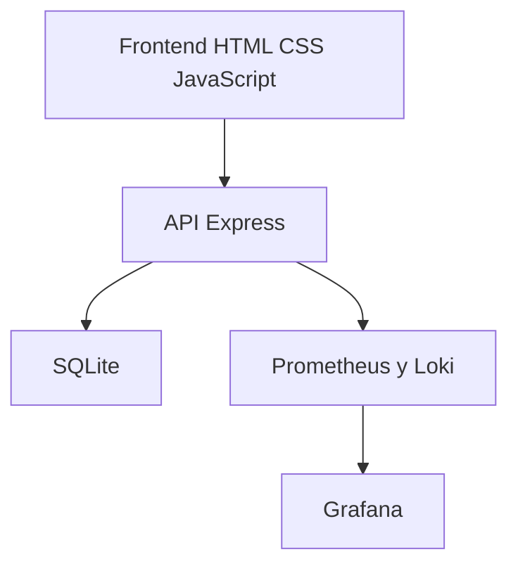

# DevOps Task Board

Proyecto académico para practicar desarrollo y operaciones con un tablero de tareas. Incluye una aplicacion web simple con frontend HTML/CSS/JavaScript, backend Node.js/Express, persistencia SQLite, pruebas automatizadas, contenedores Docker, pipeline CI/CD y monitoreo basico.

## Cómo revisar este proyecto

- [API REST](src/routes/api.js) y [servicio de tareas](src/services/taskService.js).
- [Pruebas unitarias](tests/unit/taskService.test.js) y [pruebas de integración](tests/integration/api.test.js).
- [Pipeline de integración](.github/workflows/ci.yml) y [configuración de entrega](.github/workflows/cd.yml).
- [Instalación](docs/installation.md) y [manual de operaciones](docs/operations.md).

La configuración de CI/CD y monitoreo está versionada. El despliegue remoto requiere configurar el destino y los secretos; el repositorio no acredita por sí solo un servicio de producción activo.

## Objetivo académico

Demostrar un flujo DevOps de punta a punta:

- Desarrollo de una aplicacion funcional.
- Versionado con Git y GitHub.
- Integracion continua con GitHub Actions.
- Empaquetado y ejecucion con Docker.
- Despliegue automatizado basado en imagenes.
- Observabilidad con logs, metricas y alertas.

## Arquitectura

El frontend consume la API Express; SQLite conserva las tareas. Prometheus consulta las métricas de la aplicación y Grafana presenta los paneles. Los logs se envían a Loki mediante Promtail.



## Funcionalidades

- Crear, listar, actualizar y eliminar tareas.
- Visualizar resumen de backlog.
- Exponer healthcheck y metricas Prometheus.
- Registrar logs estructurados en JSON.
- Recibir alertas simples desde Alertmanager.

## Stack tecnologico

- Frontend: HTML, CSS, JavaScript vanilla
- Backend: Node.js + Express
- Base de datos: SQLite usando `sql.js`
- Tests: Vitest + Supertest
- Analisis estatico: ESLint
- CI/CD: GitHub Actions
- Contenedores: Docker + Docker Compose
- Monitoreo: Prometheus, Grafana, Loki, Promtail, Alertmanager

## Estructura del repositorio

| Directorio | Contenido |
| --- | --- |
| `src/` | API, servicios, persistencia y frontend. |
| `tests/` | Pruebas unitarias y de integración. |
| `scripts/` | Despliegue y smoke test. |
| `monitoring/` y `grafana/` | Métricas, logs, alertas y paneles. |
| `docs/` | Guías de instalación, operación y pipeline. |
| `.github/workflows/` | Configuración de CI/CD. |

## Ejecucion local sin Docker

1. Instalar dependencias:

   ```bash
   npm install
   ```

2. Crear variables de entorno:

   ```bash
   cp .env.example .env
   ```

3. Iniciar la aplicacion:

   ```bash
   npm run dev
   ```

4. Abrir:

- Aplicacion: [http://localhost:3000](http://localhost:3000)
- Healthcheck: [http://localhost:3000/api/health](http://localhost:3000/api/health)
- Metricas: [http://localhost:3000/api/metrics](http://localhost:3000/api/metrics)

## Ejecucion con Docker Compose

```bash
docker compose up --build
```

Servicios disponibles:

- App: [http://localhost:3000](http://localhost:3000)
- Prometheus: [http://localhost:9090](http://localhost:9090)
- Alertmanager: [http://localhost:9093](http://localhost:9093)
- Loki: [http://localhost:3100](http://localhost:3100)
- Grafana: [http://localhost:3001](http://localhost:3001)

Credenciales iniciales de Grafana:

- Usuario: `admin`
- Contrasena: `admin`

## Calidad y pruebas

```bash
npm run lint
npm test
```

El pipeline CI ejecuta:

- Analisis estatico.
- Pruebas unitarias e integracion.
- Construccion de imagen Docker.
- Smoke test del contenedor.

## Pipeline CI/CD

- `ci.yml`: valida cada push y pull request.
- `cd.yml`: publica imagen en GHCR y permite despliegue remoto por SSH.

Para habilitar el despliegue remoto se deben configurar secretos en GitHub:

- `DEPLOY_HOST`
- `DEPLOY_USER`
- `DEPLOY_SSH_KEY`
- `DEPLOY_PATH`

## Monitoreo implementado

- Logs estructurados de la app.
- Recoleccion centralizada de logs con Promtail + Loki.
- Metricas de sistema y aplicacion con Prometheus.
- Dashboard preconfigurado en Grafana.
- Alertas basicas:
  - `ApplicationDown`
  - `TaskBacklogHigh`

## Documentacion adicional

- [Guia de instalacion](docs/installation.md)
- [Documentacion del pipeline](docs/pipeline.md)
- [Manual de operaciones](docs/operations.md)
- [Guion de presentacion](docs/presentation.md)

## Propuesta de reparto del trabajo

- Integrante 1: backend, pruebas y base de datos.
- Integrante 2: Docker, GitHub Actions y despliegue.
- Integrante 3: monitoreo, documentacion y presentacion.

## Siguientes mejoras posibles

- Autenticacion simple.
- Migraciones versionadas.
- Despliegue real en una VM o servicio cloud.
- Notificaciones por correo o Slack para alertas.
